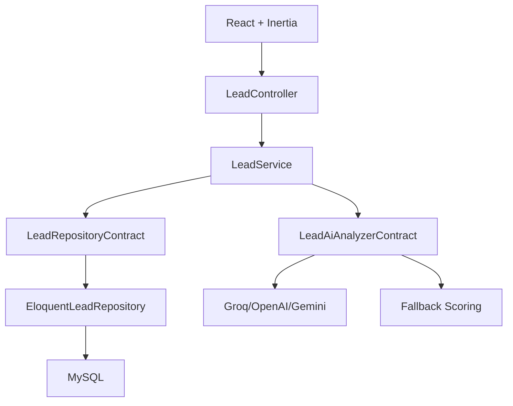

# 04 - Arquitectura

## Capas

- UI: React + Tailwind.
- HTTP: Controllers y Form Requests.
- Business: Services.
- Data: Repositories y Eloquent Models.
- AI: contratos, prompts, providers y parser.
- Persistence: MySQL.

## Escalabilidad

La arquitectura permite mover el analisis IA a queues, cachear dashboard y versionar API sin cambiar la UI.
